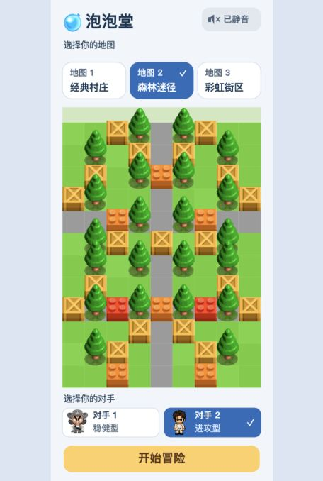

# 泡泡堂 BNB Demo



一个可嵌入个人作品集的泡泡堂风格网页小游戏。玩家需要在 90 秒内利用泡泡、地形和道具击败所选机器人。

当前界面采用 **414 × 896 px 手机竖屏**设计，按可用屏幕等比缩放。开始界面可预览并选择三张地图；对局顶部显示地图名与信息卡，中间完整展示地图，底部提供左侧虚拟摇杆和右侧放泡泡按钮，支持双指同时操作。地图重新排布为 9 × 12 格的竖向村庄，每格显示约 41 px；人物、建筑、道具与爆炸统一放大，完整地图保持在同一屏内。

项目使用 Phaser 3、TypeScript 和 Vite 开发，全部游戏逻辑在浏览器本地运行，不需要后端、账号或联网服务。

> 这是用于个人作品集和技术学习的非商业同人 Demo，与《泡泡堂》官方及其权利方不存在隶属或合作关系。

## 游戏内容

- 三张 9 × 12 的竖向单屏地图，支持真实布局预览、选图和结算后换图；
- 开局选择地图与对手，每局 1 名玩家对战 1 名机器人；稳健型优先拾取附近道具，进攻型优先寻找攻击机会；
- 机器人按真实爆炸范围选择攻击位置，途中更新追击路线，放泡前检查逃生时间，并躲避连锁爆炸；
- 平滑移动、独立 X/Y 轴碰撞与贴墙滑动；
- 泡泡放置、倒计时、十字爆炸和连锁伤害；
- 可破坏建筑、可推动箱子和随机道具；
- 炸弹数量、爆炸范围和移动速度成长；
- 角色四方向行走、静止和死亡动画；
- 根据角色脚底位置进行动态纵深排序；
- 开始界面、游戏界面、倒计时、结算与重新开始；
- Menu 和 Village 两套背景音乐。

## 地图选择

进入游戏后，点击「地图 1 / 地图 2 / 地图 3」切换预览，再点击「开始冒险」。返回选择页会保留本次会话中的地图选择；「再玩一局」会重置当前地图，不会保留已炸毁的障碍。

| 地图 | 名称 | 布局特点 |
| --- | --- | --- |
| 地图 1 | 经典村庄 | 房屋、树木与十字道路，布局均衡 |
| 地图 2 | 森林迷径 | 更多树木与迂回通道，适合利用岔路躲避 |
| 地图 3 | 彩虹街区 | 彩色房屋、开放广场与长街，注意连锁爆炸 |

三张地图使用项目已有素材重新组合，建筑、树木和箱子布局定义在 `src/data/maps.ts`，三张地图都保留原来的绿色草地与灰色道路，地面统一定义在 `src/data/ground.ts`。选图预览与实际对局共用地图数据、素材尺寸和地面颜色，新增地图也应检查出生点逃生空间与通道连通性。

## 操作方式

| 操作 | 按键 |
| --- | --- |
| 手机移动 | 拖动左侧虚拟摇杆（八方向移动、支持贴墙滑行，松手停止） |
| 手机放泡泡 | 点击右侧「放泡泡」按钮 |
| 向上移动 | `W` 或 `↑` |
| 向下移动 | `S` 或 `↓` |
| 向左移动 | `A` 或 `←` |
| 向右移动 | `D` 或 `→` |
| 放置泡泡 | `Space` |

选图页和对局界面右上角的声音按钮可切换静音，显示「声音开」或「已静音」。静音状态在本次运行中跨地图切换和重新开始保留。

摇杆斜推时保留两个移动方向，撞墙后沿未受阻方向滑行；轻微偏斜仍按直线移动，角色朝向和推箱保持四方向。移动速度沿用键盘的逐轴规则。

浏览器通常要求用户先进行一次点击，之后才允许播放背景音乐。

## 技术栈

- [Phaser 3](https://phaser.io/)：游戏场景、渲染、动画、输入与音频；
- TypeScript：游戏逻辑与类型约束；
- Vite：本地开发与生产构建；
- Vitest：规则、机器人、箱子、爆炸和 UI 逻辑测试；
- Sharp：仅用于维护角色精灵图的素材处理脚本，不参与游戏运行。

## 本地运行

请先安装 Node.js 和 npm，然后执行：

```bash
git clone https://github.com/Moumoon1/BNBdemo.git
cd BNBdemo
npm install
npm run dev
```

浏览器打开终端中显示的本地地址即可试玩。

手机与电脑连接同一个 Wi-Fi 时，执行 `npm run dev -- --host 0.0.0.0`，然后用手机浏览器打开终端显示的 Network 地址即可试玩。

## 测试与构建

运行自动化测试：

```bash
npm test
```

生成生产环境静态文件：

```bash
npm run build
```

构建结果位于 `dist/`。可以将该目录部署到 Vercel、Netlify 或其他静态托管服务，也可以嵌入现有网站。

## 项目结构

```text
BNBdemo/
├── public/assets/       # 图片、精灵图和背景音乐
├── scripts/             # 素材处理脚本
├── src/
│   ├── ai/              # 机器人决策
│   ├── config/          # Phaser 游戏配置
│   ├── data/            # 地图与动态参数配置
│   ├── domain/          # 坐标、方向和规则等纯逻辑
│   ├── entities/        # 玩家、机器人、泡泡、道具和箱子
│   ├── scenes/          # 启动、菜单和游戏场景
│   ├── systems/         # 移动、碰撞、爆炸、AI 和渲染系统
│   └── ui/              # 计时器、侧栏和结算组件
├── index.html
└── vite.config.ts
```

代码按实体、规则、系统、场景与 UI 分层，动态参数集中在 `src/data/`，尽量保持高内聚、低耦合，避免把玩法数值散落在渲染代码中。

## 素材与参考

本项目由 [Moumoon1](https://github.com/Moumoon1) 与 Codex 协作开发。部分视觉素材来自 GitHub 开源项目或由 AI 辅助生成；实现过程中参考了以下项目和文章：

- [visolleon/bnb](https://github.com/visolleon/bnb)：地图、角色和 UI 素材，以及原版风格表现参考；
- [tpoisonooo/BnB](https://github.com/tpoisonooo/BnB)：泡泡堂玩法与机器人逻辑参考；
- [85bits — Bomberman Part 6: Bomb Rules](https://85bits.pages.dev/posts/bomberman-part-6-bomb-rules/)：分轴碰撞与墙面滑行思路。

相关素材和原始项目的权利及许可归各自作者所有。使用或再发布前，请同时检查对应来源仓库的许可证与素材授权范围。

## 当前定位

这是面向个人作品集的可玩 Demo，重点展示网页游戏架构、角色移动手感、碰撞处理、纵深遮挡、爆炸规则与基础机器人决策，不以完整复刻商业游戏为目标。

